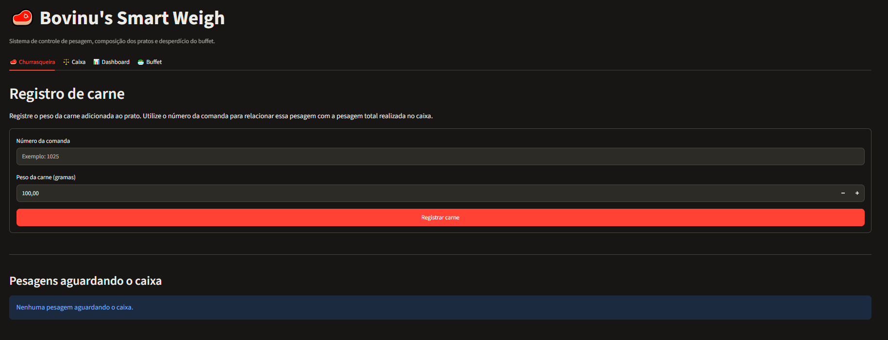
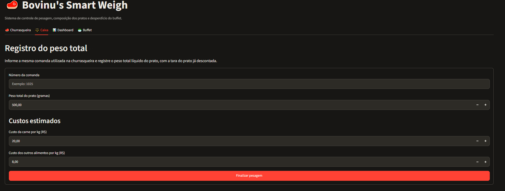
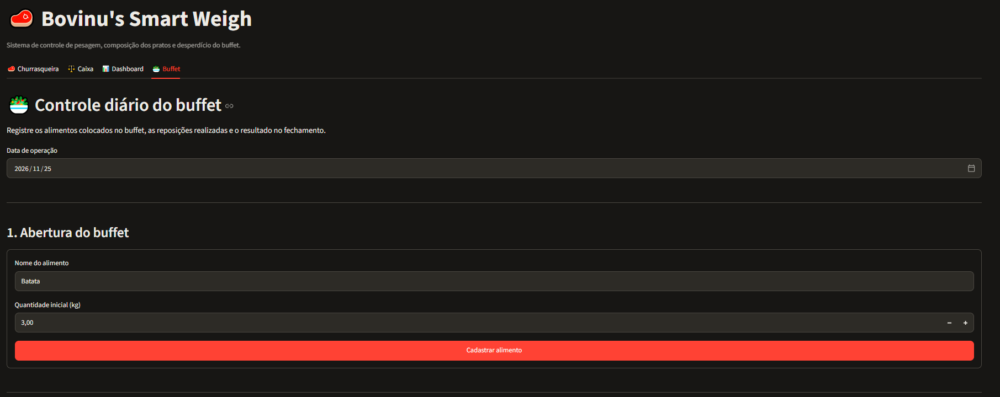
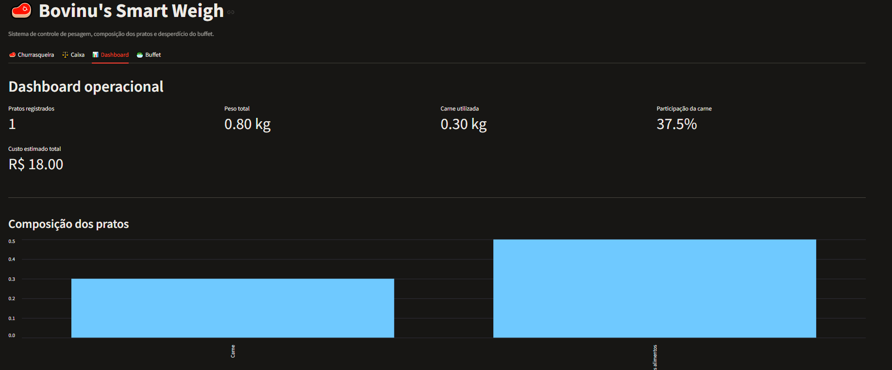

# 🥩 Bovinu's Smart Weigh

### Inteligência de dados para análise da composição dos pratos

## 📌 Sobre o projeto

O Bovinu's Smart Weigh é uma solução desenvolvida para o Bovinu's
Grill & Beer — Unidade Augusta, com o objetivo de melhorar a
visibilidade sobre a composição dos pratos servidos no almoço.

O sistema registra separadamente o peso das carnes e dos demais
alimentos, calcula os percentuais de composição e apresenta
estimativas de custos em um painel gerencial, também o programa 
registra através da comanda.

## 🎯 Problema identificado

No buffet por quilo, o restaurante conhece o peso total dos pratos,
mas não possui necessariamente informações sobre a participação
individual das carnes e dos demais alimentos.

Essa falta de visibilidade dificulta a análise dos custos dos
ingredientes e da composição dos pratos servidos.

## 💡 Solução proposta

Desenvolver um sistema de monitoramento do consumo alimentar em churrascarias, 
capaz de registrar e analisar a quantidade de acompanhamentos e proteínas (carnes) 
consumidas pelos clientes, permitindo identificar padrões de consumo e gerar
 informações estratégicas para o estabelecimento.

## ⚙️ Tecnologias utilizadas

- Python
- Streamlit
- SQLite
- Pandas
- Git e GitHub

## 🖥️ Demonstração da solução

### 1. Tela inicial


### 2. Registro do peso total


### 3. Controle diário do buffet


### 4. Dashboard operacional


## 🎥 Vídeo de apresentação

[Assistir à demonstração do projeto](https://youtu.be/_C43TV8-GYY)

## 📊 Apresentação

[Visualizar os slides do projeto](docs/apresentacao-bovinus-smart-weith.pdf)

## 🏗️ Arquitetura e desenvolvimento

Consulte os documentos:

- [Arquitetura](docs/arquitetura.md)
- [Etapas de desenvolvimento](docs/desenvolvimento.md)

## 🚀 Como executar

1. [Acessar app](https://bovinus-smart-weigh-jl7pw6plkdzbjrm9r6encc.streamlit.app/)
```

## 📈 Resultados esperados

- Maior visibilidade da composição dos pratos.
- Melhor acompanhamento da participação das carnes.
- Estimativas de custos dos ingredientes.
- Apoio à tomada de decisões gerenciais.

## 👥 Equipe

Lucas Souza de Castro - RA:2026200801
Valdeyr Nicacio - RA:2025205936

Projeto desenvolvido para o Hackathon,
com foco na jornada do cliente no almoço do
Bovinu's Grill & Beer — Unidade Augusta.
